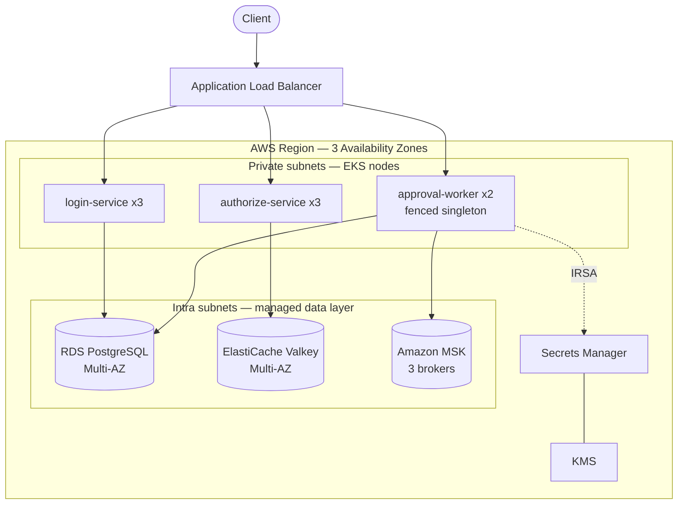

<div align="center">

# ⚙️ Production Kubernetes on AWS — Compose → EKS HA Migration

**Take a real microservices platform from a single-host Docker Compose stack to a
three-zone, highly-available Kubernetes deployment on AWS — the way a senior
platform engineer would.** Then prove it survives a zone loss on camera.


[](./LICENSE)

📺 **Watch the build:** [devopsbymuh on YouTube](https://youtube.com/@devopsbymuh)

</div>

> [!NOTE]
> This project reproduces the shape of a real, senior-level platform-engineering job:
> an identity platform (identity provider, policy decision point, workflow engine)
> backed by PostgreSQL, Valkey, and Kafka — migrated from Compose to production
> Kubernetes with genuine three-zone HA, GitOps, and certified failover drills.
> The services are deliberately small. **The value is everything around them.**

---

## 📐 Architecture

One set of container images runs in three places — only the connection strings change.
On AWS the whole data layer is **managed** (RDS, ElastiCache, MSK), so its HA is AWS's
job and the cluster only worries about the stateless services and the fenced singleton.



Full diagrams (service graph, AWS topology, fencing sequence): **[docs/architecture.md](docs/architecture.md)**
· Whiteboard explainer for talks/video: **[docs/diagrams/architecture.excalidraw](docs/diagrams/architecture.excalidraw)** + **[walkthrough script](docs/diagrams/whiteboard-walkthrough.md)**

| | Local (Compose) | kind (HA demo) | **AWS (production)** |
|---|---|---|---|
| Orchestration | Docker Compose | kind, 3 "zones" | **EKS across 3 AZs** |
| PostgreSQL | container | in-cluster | **RDS Multi-AZ** |
| Valkey | container | in-cluster | **ElastiCache Multi-AZ** |
| Kafka | Redpanda | in-cluster | **Amazon MSK (3 brokers)** |
| Secrets | `.env` | k8s Secret | **Secrets Manager + KMS + IRSA** |

## 🧩 The services

- **login-service** — identity provider; issues short-lived JWTs (PostgreSQL).
- **authorize-service** — policy decision point; caches decisions in Valkey.
- **approval-worker** — a workflow **singleton that must never run twice**. Runs 2
  replicas for availability, but only the leader acts, guarded by a Postgres
  **fencing token**. Emits events via a **transactional outbox** to Kafka and
  consumes them **idempotently**.

## 🚀 Quickstart

### 1. Run it locally (the "before")
```bash
cp .env.example .env
make up            # build + start the whole stack on Docker Compose
make smoke         # end-to-end test: login → authorize → approval
```

### 2. See the singleton fail over (Compose)
```bash
make fencing-demo  # kill the leader; a follower takes over, fencing token increments
```

### 3. The real HA demo on Kubernetes (free, local)
```bash
make kind-up       # 3-"zone" kind cluster + stores + platform via Helm
make chaos         # kill the NODE hosting the leader under load
```
```
== KILL the node hosting the leader (abrupt zone loss) ==
  stopped kind node container: ha-platform-worker2
== wait for a new leader on a surviving zone ==
  NEW leader : ...-5dl2b on node ha-platform-worker
  ✓ fencing token 2 -> 3 — the lost leader is fenced out for good.
== confirm work continues (drive fresh load at the NEW leader) ==
  processed counter: 11 -> 21
  ✓ approvals still being processed after the zone loss.
```

### 4. Deploy to AWS
See **[docs/runbooks/aws-cutover.md](docs/runbooks/aws-cutover.md)**. In short:
`cd infra && terraform apply`, push images to ECR, wire the outputs into
`charts/platform/values-aws.yaml`, then `helm upgrade --install` (or Argo CD).
**It costs money — tear down with `make aws-destroy`.**

## 🗂️ Repository layout

```
app/          three FastAPI services + Dockerfiles
charts/       platform-lib (library chart: workload archetypes + security defaults)
              + per-service charts + umbrella + values-kind/values-aws overlays
infra/        Terraform: EKS, VPC, RDS, ElastiCache, MSK, KMS, Secrets, IRSA, ECR, S3
deploy/       kind cluster + dev stores, Argo CD ApplicationSet
docs/         architecture, ADRs, runbooks (HA drills, cutover, backup/restore)
scripts/      smoke test, fencing demo, kind-up, chaos
Makefile      one-command workflows (make help)
```

## 🎓 What this demonstrates

Compose→multi-zone K8s migration · Helm **library chart** authoring · Argo CD
ApplicationSets with sync-wave-ordered migrations · **fencing tokens vs advisory
locks** · transactional outbox + idempotent consumers · restricted Pod Security,
non-root, PodDisruptionBudgets, zone spread · IRSA least-privilege · managed data
layer (RDS/ElastiCache/MSK) · backup/restore into a clean environment · scripted HA
certification drills.

## 📄 License

MIT — see [LICENSE](./LICENSE).

<div align="center"><sub>Built for <a href="https://youtube.com/@devopsbymuh">devopsbymuh</a> — real DevOps, built and proven on camera.</sub></div>
