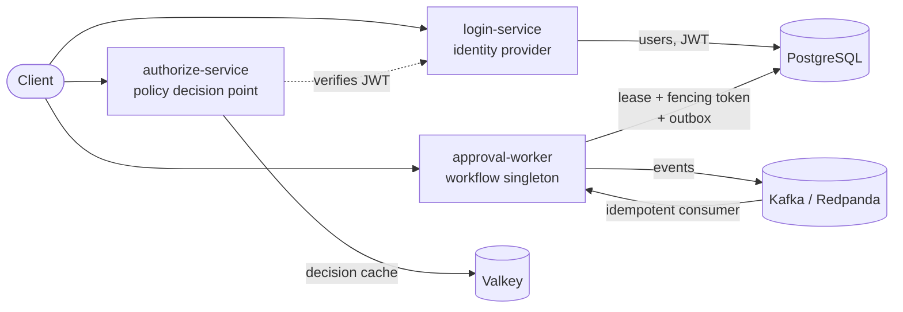
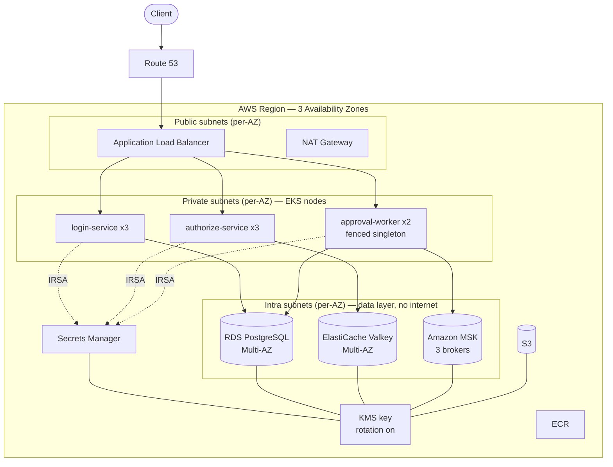
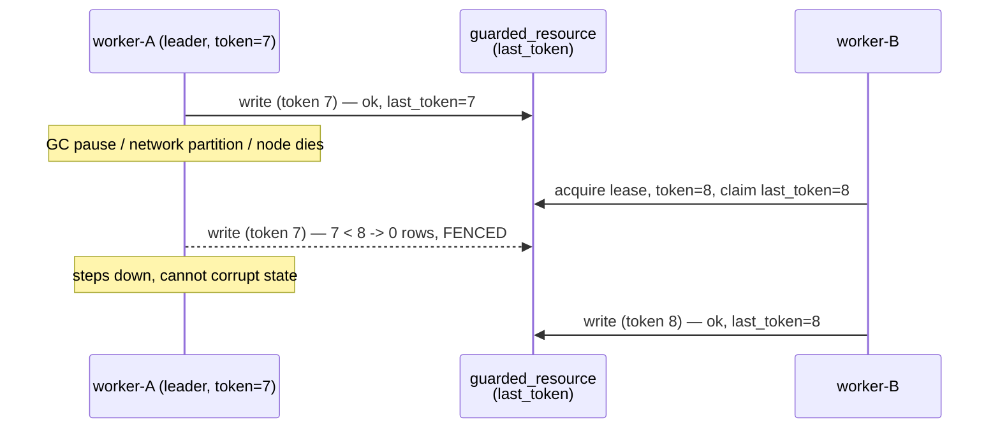

# Architecture

Three environments, **one set of container images**. The services read every
dependency from the environment, so the same image runs against local containers,
in-cluster dev stores, or managed AWS services — only connection strings change.

| Concern | Local (Compose) | kind (HA demo) | **AWS (production)** |
|---|---|---|---|
| Orchestration | Docker Compose | kind, 3 "zones" | **EKS across 3 AZs** |
| PostgreSQL | container | in-cluster pod | **RDS Multi-AZ** |
| Valkey | container | in-cluster pod | **ElastiCache Multi-AZ** |
| Kafka | Redpanda | in-cluster pod | **Amazon MSK (3 brokers)** |
| Secrets | `.env` | k8s Secret | **Secrets Manager + KMS** |
| Identity | — | — | **IRSA (per-service IAM)** |

## Services

- **login-service** (`web` archetype) — registers users, issues short-lived JWTs.
- **authorize-service** (`web` archetype) — verifies the JWT, evaluates a small
  AuthZEN-style policy, caches decisions in Valkey. A Valkey outage degrades
  latency, not correctness.
- **approval-worker** (`fenced-singleton` archetype) — 2 replicas, but only the
  leader acts. A Postgres **fencing token** guarantees a stale leader can never
  write twice. Emits events via a **transactional outbox** to Kafka; consumes them
  **idempotently**.

## AWS production topology

**Why managed stores?** The data layer's HA becomes AWS's responsibility (RDS
Multi-AZ synchronous standby, ElastiCache failover, MSK spread across AZs), so the
Kubernetes layer only has to keep the *stateless* services and the *fenced
singleton* healthy. It also means the singleton's hardest failure mode — a database
failover — is a first-class, testable event (see the fencing sequence below).

## The fencing token (why the singleton is safe)

The token is a strictly increasing number handed out on every leadership takeover.
Every state-changing write carries it; the store rejects any token older than the
newest it has seen. Advisory locks alone cannot do this — a paused lock holder still
"holds" the lock. See [ADR-0002](adr/0002-fencing-tokens.md).
